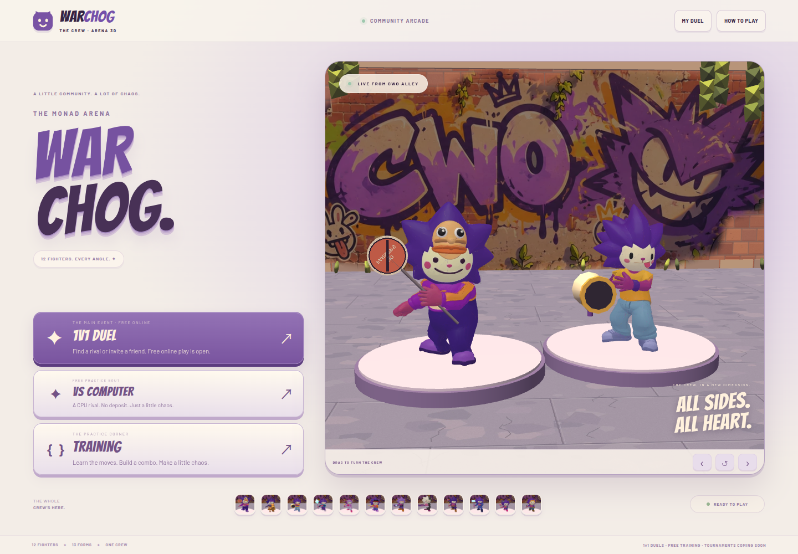

# WARCHOG

**Play:** [warchog.vercel.app](https://warchog.vercel.app) — 3D hub, Training and VS Computer.

A browser-based 3D arena fighter for desktop and mobile. Pick from **12 fighters / 13 appearances**, fight across **five arenas**, and move freely around your opponent with a rotating camera.



## What is included

- Live 3D home screen, character selection, rigged fighters, complete arena surroundings and skies.
- Training with a dummy and combat tools, plus local VS Computer.
- Free online 1v1: matchmaking, private room codes, ready checks, server-authoritative combat, reconnect and forfeit.
- Monad testnet prize duels: wallet authentication, exact entry approval, two-player funding, official result signatures, settlement, refunds and separate credit claims.
- Original escrow sources, ABI, deployment metadata and Foundry tests, preserved from the contract repository.

This is a playable prototype. Fighters currently share a combat kit; tournaments are marked Coming soon.

## Run locally

Requires **Node.js 24+** and npm. Runtime models, textures, fonts and audio are already included; Meshy credentials are not needed to play.

```bash
git clone https://github.com/pupulion21/warchog.git
cd warchog
npm ci
npm run dev -- --port 5187
```

Open **http://127.0.0.1:5187**. The Vite development server also runs the HTTP/WebSocket backend on the same origin. Training, CPU and free online work without a wallet or server signer.

For free online testing, open two separate browser profiles or a normal window plus an incognito window. Select **1v1 Duel**, create a free room, join its code in the other window, then ready both players. Use different sessions; two tabs in one profile share a player identity.

For a built game with the standalone backend:

```bash
npm run build
npm run server
```

Open **http://127.0.0.1:5190**. This command serves the frontend and backend together. Keep the process running for online matches. For a remote host, configure `WARCHOG_HOST` / `WARCHOG_PORT` in the process environment and use an HTTPS proxy that supports WebSockets; static hosting alone cannot run online play or sign results.

## Vercel deployment

`vercel.json` deploys the Vite frontend with `VITE_WARCHOG_STATIC_HOST=true`. This hosted build includes the 3D hub, character and map selection, Training and VS Computer. Online and prize-entry buttons show Coming soon because this deployment does not run the single-process Node room server or its private SQLite database. Existing public contract lookup and eligible wallet recovery remain available.

The current `archzxy/warchog` project was deployed through the CLI. Automatic GitHub deployment is not connected yet: the GitHub account linked to Vercel needs write/admin access to `pupulion21/warchog`.

Local development and the standalone Node server retain online/prize support. Do not upload `.local/`, environment files, databases or the signer to a static deployment. Deploy the persistent backend separately or adapt room ownership and storage before enabling hosted online play. `.vercelignore` excludes private and authoring files from CLI uploads.

```bash
vercel --prod
```

## Controls

| Action | Desktop |
| --- | --- |
| Move | W A S D |
| Run | Shift |
| Melee / projectile / slam | U / I / O |
| Dodge | J |
| Jump | K or Space |
| Toggle target lock | P |
| Orbit / zoom camera | Drag / mouse wheel |
| Rotate / recenter camera | Z and X / C |
| Pause or settings | Esc |

Touch controls are available on mobile. Esc pauses local practice; online matches continue on the server while settings are open.

## Prize duels and server configuration

Prize play uses the existing **Monad testnet** deployment. Each player deposits **1 test USDC**. A Finished or Forfeit outcome credits **1.90** to the winner and **0.10** to the treasury; Void returns funded entries. Settlement allocates credits, and **Claim** is a separate token transfer.

The flow is: connect wallet and sign in → choose fighters and lock terms → approve the exact entry → deposit from both wallets → fight → submit the server-confirmed result → claim credit. Combat starts only after the backend verifies the contract is Active. Each transaction requires its own wallet confirmation.

| Public deployment | Value |
| --- | --- |
| Network / chain ID | Monad testnet / `10143` |
| Escrow | `0xFf4553156a4F75feB47674bB8e96C537404413bd` |
| Entry token, 6 decimals | `0x534b2f3A21130d7a60830c2Df862319e593943A3` |

A fresh clone defaults to prize entry disabled. To configure the server privately:

```bash
mkdir -p .local
cp .env.example .local/warchog-server.env
chmod 600 .local/warchog-server.env
```

Edit that private file locally. Set `WARCHOG_SIGNER_PRIVATE_KEY` to the dedicated result signer registered in the escrow and set `WARCHOG_PAYMENTS_ENABLED=true`. Then check readiness and restart the server:

```bash
npm run payments:check
```

The backend verifies live chain policy, signer, epoch, pause/revocation state and deadlines before enabling entry. Its key signs official match results; players submit transactions from their wallets. **Never put a private key in `VITE_*`, frontend code, public assets, Git, or chat.** The server config, SQLite database and local authoring files are excluded from Git.

The deployed EIP-712 domain remains **`CHOG Paid Duel` / `2`** for compatibility. The deployment JSON is historical metadata; current server configuration and live contract checks determine application readiness. See [contract integration](docs/warchog-contract-integration.md) and [backend operations](docs/online-server.md).

## Verification

```bash
npm test                 # Node combat, server, auth and payment tests
npm run build            # Frontend + backend type checks and production build
npm run contracts:test   # Original Solidity suite; requires Foundry
npm run test:paid        # Real local EVM + two-browser paid-duel acceptance
```

Browser QA requires Python's `playwright` package and an installed Chromium. Set `CHOG_QA_CHROMIUM` to its executable path. `test:paid` also requires `forge` and `anvil` on PATH; it creates an isolated localhost chain and cleans up its processes. It uses mock USDC and temporary test keys, with no public-chain transactions.

Recorded checks for this implementation:

- **11 public Vercel browser checks passed** (desktop and mobile emulation): [deployment report](validation/vercel-deployment-report.json).
- **50 Node tests passed**, plus the production build.
- **194 browser/standalone regression checks passed**: [report](validation/online-production-report.json).
- **23 real local-EVM/browser payment checks passed**: [report](validation/paid-local-e2e-report.json), including funding, result settlement, claims, token-transfer failure, Void, Forfeit and recovery.

Local EVM tests and desktop/mobile browser emulation have passed. A public-testnet two-wallet paid match and physical-phone performance validation remain to be performed.

## Project layout and limits

| Path | Contents |
| --- | --- |
| `src/` | Babylon.js UI/3D game, Rapier combat, wallet and contract binding |
| `server/` | Authoritative WebSocket rooms, SQLite persistence and result signer |
| `contracts/` | Original escrow, ABI, deployment and Foundry tests |
| `public/assets/` | Ready-to-play models, textures, fonts and audio |
| `tests/`, `tools/`, `validation/` | Automated checks, authoring tools and selected reports |
| `research/`, `docs/` | Design research and implementation notes |

The backend currently owns rooms in one Node process. Reconnect is supported, but a process restart interrupts an active physics world; persisted results and payment recovery remain available. Multiple replicas need shared room ownership/routing. Preserve the private SQLite database and signer configuration across deployments.

Raw Meshy responses/downloads and local source archives (`assets-source/`, `exports/`) are excluded; optional `assets:*` authoring scripts require those local inputs. They are unnecessary for normal installation, builds and play.

See [LICENSE](LICENSE), [asset and dependency notices](THIRD_PARTY_NOTICES.md), and [contract notices](contracts/THIRD_PARTY_NOTICES.md). Character and artwork rights remain with their respective owners; the code license does not grant rights to third-party characters.
